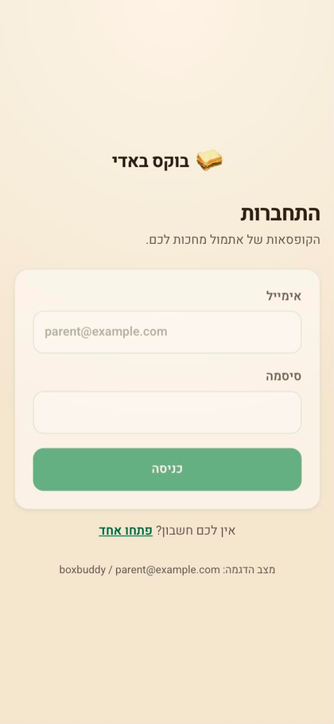
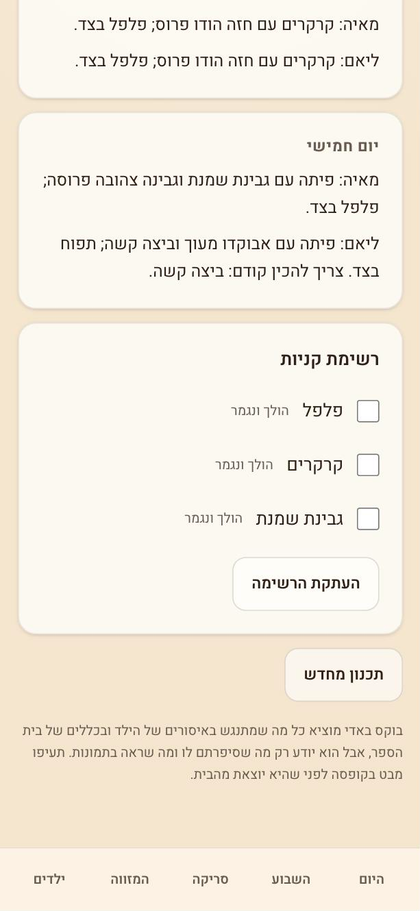
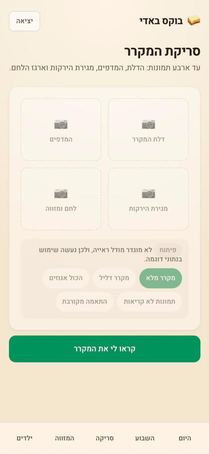

# Box Buddy · בוקס באדי

Lunchbox plans made from what's already in your fridge, for parents of
school-aged children with allergies, school rules and strong opinions about
whether the cucumber may touch the bread.

**The interface is Hebrew, right-to-left.** Code, comments, identifiers and
ingredient slugs stay in English; only what a parent reads is translated.
`src/lib/catalog.ts` holds the Hebrew display names and is the single source
for `supabase/seed.sql`, so the two cannot drift. There is no i18n framework
and no second locale — adding one would mean lifting the strings out of the
components, which is a larger change than this app currently needs.

## What it looks like

| התחברות | היום | השבוע |
|---|---|---|
|  |  |  |

| רשימת קניות | סריקת המקרר | המזווה |
|---|---|---|
|  |  |  |

The children screen, where allergies and school rules are set, is in
[docs/screenshots](docs/screenshots).

## Running it

```bash
npm install
npm run dev
```

That's the whole setup. With no `.env`, the app runs against a seeded
in-process household and a fixture-backed vision provider, so every screen and
every planner path works with no database and no API key.

Sign in to the seeded household with **parent@example.com / boxbuddy** — the
sign-in screen shows these whenever the in-process adapter is in use. "פתחו
אחד" creates a fresh account with an empty household of its own.

| Script | What it does |
|---|---|
| `npm run dev` | Dev server on :3000 |
| `npm test` | Planner, scan-normalization, entitlement and shopping tests |
| `npm run typecheck` | `tsc --noEmit` |
| `npm run build` | Production build |
| `npm run db:seed:gen` | Regenerates `supabase/seed.sql` from `src/lib/catalog.ts` |

## How it fits together

```
src/lib/
  catalog.ts        the ~85-ingredient vocabulary (Hebrew names, English slugs)
  domain.ts         shared types: children, rules, compositions, plans
  planner/          pure, deterministic, unit-tested
    constraints.ts    stage 1 — hard safety filter (the file that matters)
    compose.ts        stage 2 — candidate lunchboxes
    score.ts          stage 3 — variety, waste, preferences
    index.ts          daily / weekly / rescue modes
    instructions.ts   renders a composition as the Hebrew sentence a parent reads
  vision/           VisionProvider interface + stub and live providers
  entitlements.ts   every free/premium limit, in one place
  shopping.ts       missing-ingredient aggregation
  auth/             scrypt password hashing and the signed session cookie
  db/               Repo interface + memory and Supabase adapters
src/app/(auth)/     sign-in and sign-up, outside the session gate
src/app/(app)/      the five screens, behind it
src/app/actions.ts  Server Actions — every mutation, every tier check
supabase/           migration (schema + RLS) and generated seed
```

### Accounts

Each parent signs in with an email address and a password. Both adapters
implement the same three calls — `createAccount`, `authenticate`, `endSession` —
so the flow is identical whichever one is running:

- **Supabase**: Supabase Auth stores and checks the password, then the sign-up
  writes the household and the profile row that every RLS policy reads.
- **In-process**: passwords are scrypt-hashed with a per-password salt and
  compared in constant time; the session is a user id in an HMAC-signed cookie
  (`AUTH_SECRET`, required in production). Each account gets its own household,
  so two accounts in the same process never see each other's children.

`src/app/(app)/layout.tsx` redirects a visitor with no session to `/login`.
That guards what renders; the Server Actions check the session themselves,
because a layout never guards what can be called.

### Safety

Allergy handling is the one place a bug here hurts someone. The rules:

- `planner/constraints.ts` runs first and its output is never widened again.
  Every later stage can only pick from what it returned.
- A child `ban`, a school rule, an out-of-stock marker or an **unrecognised
  ingredient** all remove an item. An ingredient we cannot identify is treated
  as absent, never as safe.
- Vision confidence never feeds an allergy decision. A fuzzy catalog match is
  always shown to the parent before it enters the inventory.
- The planner reports "nothing safe can be made" rather than ever relaxing a
  ban — rescue mode included.
- Every generated plan carries a line telling the parent to check the box.
  The app is a help, not the last line of defence.

The tests in `src/lib/planner/constraints.test.ts` assert this over the whole
catalog rather than over chosen examples.

## Switching on the real pieces

**Vision.** Set `VISION_PROVIDER=anthropic` and `ANTHROPIC_API_KEY`. Nothing
else changes; `src/lib/vision/anthropic.ts` already implements the same
interface the stub does. The scan screen then sends the real photographs —
downscaled in the browser to 1568px on the long edge, which is as much detail
as the model uses.

### Measuring whether it actually works

The product rests on one assumption nothing has tested: that a photo of a real
fridge becomes a usable inventory. The fixtures cannot answer that — the same
hand wrote them and the prompt. So there is a harness:

```bash
npm run vision:try -- --slugs                     # the catalog vocabulary
npm run vision:try -- photos/door.jpg photos/shelf.jpg
npm run vision:try -- --truth photos/truth.txt photos/*.jpg
```

Shot types are assigned by position (door, shelf, drawer, pantry), as on the
scan screen. Without `--truth` it prints what the model found, split the way
the app would split it: straight into the inventory, held back for the parent
to confirm, or dropped. With `--truth` — a file of catalog slugs saying what
is really in those photos — it reports recall and precision, and names every
miss and every invention.

What to look for: recall below about 70% means scanning is a shortcut rather
than the main path, and the product should lead with the pantry checklist.
Inventions matter more than misses: a missed cucumber is a smaller lunchbox,
an invented one is a plan built on food that is not there. `photos/` is
gitignored, so your own fridge stays out of the repo.

**Database.** Set `NEXT_PUBLIC_SUPABASE_URL` and `NEXT_PUBLIC_SUPABASE_ANON_KEY`
and the app switches from the in-memory store to Postgres automatically. Then:

```bash
supabase start
supabase db reset   # applies the migration and the generated seed
```

Household isolation is enforced by row-level security, not by filters in the
query code — see `supabase/migrations/20261027000000_init.sql`.

## Not built yet

Stripe billing, the sponsored-recommendation engine, live affiliate grocery
APIs, push notifications, password reset, and inviting a second parent into an
existing household. Each has a seam waiting for it: `households.tier`, the
shopping-list export function, the `Repo` interface, and the `profiles` table,
which already allows more than one row per household.
